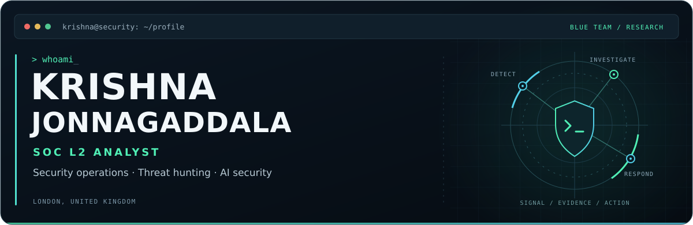

**Investigating threats. Strengthening detections. Learning to secure AI.**

 

[`whoami`](#analyst-profile) &nbsp; / &nbsp; [`toolkit`](#technical-toolkit) &nbsp; / &nbsp; [`ai-security`](#ai-security) &nbsp; / &nbsp; [`credentials`](#certifications) &nbsp; / &nbsp; [`bug-bounty`](#bug-bounty) &nbsp; / &nbsp; [`connect`](#connect)

---

## `01` / Analyst profile

I'm a **SOC L2 Analyst based in London**, investigating phishing, malware, suspicious authentication and unauthorised access across endpoint, identity and network environments. My day-to-day work centres on **Microsoft Sentinel, Microsoft Defender XDR and KQL**.

I correlate telemetry, validate indicators, establish incident scope and document findings to support response decisions. I also use investigation findings to improve detections and guide proactive threat hunting.

Before moving into security, I provided **L1/L2 IT support to 150+ users** across Windows, Active Directory, Microsoft 365 and enterprise applications. That experience helps me connect security events with how systems and people actually work.

> **Beyond the SOC:** authorised bug bounty research through **Intigriti, HackerOne and Bugcrowd**, alongside a growing focus on **AI application and agent security**.

## `02` / Technical toolkit

| Domain | Tools & capabilities |
| :--- | :--- |
| **SIEM & detection** | **Microsoft Sentinel** · Splunk · `KQL` · `SPL` · Log correlation · Detection tuning |
| **Endpoint & identity** | **Microsoft Defender XDR** · Advanced Hunting · Device timelines · Process analysis · Entra ID · Active Directory |
| **Investigation & response** | Incident scoping · Phishing & malware investigation · IOC validation · Threat hunting · Containment recommendations |
| **Threat analysis** | MITRE ATT&CK · Threat intelligence · Authentication analysis · False-positive analysis |
| **Systems & networking** | Windows · Linux · Microsoft 365 · `TCP/IP` · `DNS` · `DHCP` · VPN · Firewall logs |
| **Scripting & workflow** | `Python` · `PowerShell` · Git/GitHub · ServiceNow · Jira Service Management |

[Browse my repositories →](https://github.com/Krishna-Jonnagaddala?tab=repositories)

## `03` / AI security

I'm developing a specialism in securing AI applications and agents, and exploring how AI can support security operations while keeping findings grounded in evidence.

<table>
<tr>
<td width="50%" valign="top">

<h3><code>Security for AI</code></h3>

<strong>Learning and practical focus</strong>

<ul>
<li>LLM threat modelling and trust boundaries</li>
<li>Prompt injection and untrusted content</li>
<li>RAG poisoning, data exposure and access controls</li>
<li>Agent permissions, least privilege and auditability</li>
</ul>

</td>
<td width="50%" valign="top">

<h3><code>AI for security</code></h3>

<strong>Exploration and next portfolio milestones</strong>

<ul>
<li>Evidence-grounded investigation support</li>
<li>Analyst review and approval of response actions</li>
<li>Repeatable detection testing and evaluation</li>
<li>An AI security assessment around EVOPT</li>
</ul>

</td>
</tr>
</table>

## `04` / Certifications

| Certification | Issuer |
| :--- | :--- |
| **Microsoft Certified: Security Operations Analyst Associate (SC-200)** | Microsoft |
| **CompTIA Security+ (SY0-701)** | CompTIA |
| **Blue Team Level 1 (BTL1)** | Centri |
| **Certified Cybersecurity Technician (C\|CT)** | EC-Council |
| **Google Cybersecurity Professional Certificate** | Google |
| **AI Security (AI1) Certificate** | TryHackMe |
| **Cyber Security 101 (SEC1) Certificate** | TryHackMe |

## `05` / Bug bounty researcher profiles

Authorised research. Programme scope. Responsible disclosure.

## `06` / Connect

I'm interested in **security operations, detection engineering and roles with an AI security focus**. I'm happy to connect with people working on practical security research and defensive tooling.

 

<code>Curiosity → Evidence → Better defences</code>

